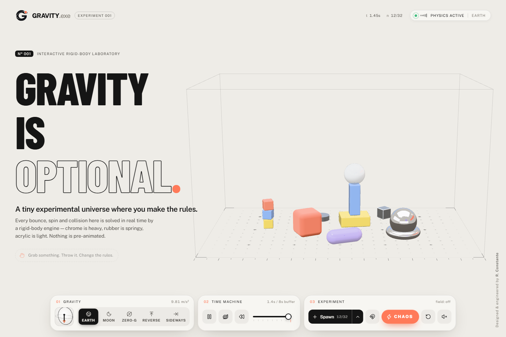

# GRAVITY.exe — *Gravity is optional.*

A tiny experimental universe where you make the rules. An interactive 3D rigid-body playground built with React Three Fiber and Rapier. Every bounce, spin and collision is simulated live. Nothing is pre-animated.



[View the mobile layout](docs/screenshots/gravity-mobile.png).

## Run it

```bash
npm ci
npm run dev        # http://localhost:5173
npm run build      # type-check + production bundle in dist/
npm run preview    # serve the production build
npm run typecheck  # TypeScript only
```

Requires Node.js 20.19+ (20.x) or 22.12+ and a WebGL-capable browser. Dependencies are locked in `package-lock.json`.

## Branding and typography

Public Sans handles interface text and tabular readouts; Barlow Condensed gives the headline its own character. Both are bundled locally through Fontsource, so no Google Fonts request is needed. Their upstream licenses are included in their respective packages.

The transparent orbital G mark is used in the header and browser icon. The [full-resolution PNG](docs/branding/gravity-mark-source.png), [web asset](public/brand/gravity-mark.png), and [generation notes](docs/branding/README.md) are included in the repository.

## Controls

| Action | Mouse / touch | Key |
| --- | --- | --- |
| Grab & throw | drag an object, release while moving | — |
| Orbit / zoom | drag empty space / wheel or pinch | — |
| Gravity: Earth · Moon · Zero-G · Reverse · Sideways | gravity selector | `1`–`5` |
| Pause / play | ⏸ | `Space` |
| Slow motion (×0.3) | snail | — |
| Rewind (hold) | ⏪ (hold) or drag the timeline | hold `R` |
| Resume from the displayed moment | Resume | `Enter` / `Esc` |
| Magnet on/off | magnet | `M` |
| Flip polarity | ± button | hold `Shift` |
| Spawn (choose type with ▲) | Spawn | `N` |
| Chaos | CHAOS | `C` |
| Reset experiment | ↺ | `X` |
| Sound (off by default) | speaker | — |

## Architecture

```
src/
  lib/
    physicsConfig.ts     tuning: timestep, gravity presets, materials, objects, composition, magnet
    physicsController.ts imperative core: body registry, drag, magnet, chaos, spawn, reset, time machine
    physicsHistory.ts    preallocated ring buffer of snapshots
    store.ts             tiny external UI store (useSyncExternalStore)
    objectFactory.ts     procedural geometry, colliders, cached physical materials
    audio.ts             Web Audio collision synth (no samples)
    device.ts            reduced-motion, quality tier, WebGL detection
  hooks/
    usePhysicsHistory.ts owns the simulation clock + records history every fixed step
    useObjectDrag.ts     pointer → camera ray → drag plane → controller
    useMagneticField.ts  pointer → magnet probe position (forces applied in the step)
    useKeyboardShortcuts.ts
  components/
    ExperienceCanvas.tsx Canvas, lights, procedural studio environment, perf monitor
    PhysicsWorld.tsx     <Physics> + room + bodies + effects
    PhysicsObject.tsx    rigid body, hand-authored colliders, squash spring, trail, collision events
    LabRoom.tsx          static colliders, shadow-catcher floor, shader dot grid, hairline boundaries
    MagnetField.tsx      probe glow, spiral field particles, curved field lines
    ImpactEffects.tsx    pooled contact ripples + chaos shockwave
    CameraRig.tsx        responsive asymmetric framing (view offset) + intro camera move
    GravityIndicator.tsx mini 3D gimbal that tracks the live gravity vector
    HeroOverlay / ControlDock / GravityControls / TimeMachineControls / SpawnControls /
    ExperimentControls / FeedbackLayer / ui.tsx
```

**Physics state is kept separate from UI state.** React holds only presentation state: the selected mode, open panels, and which bodies exist. Transforms, velocities, drag, magnet and history live in `physicsController`, so React never re-renders at simulation rate.

### Simulation clock

`<Physics>` is mounted `paused`, so the app decides when time moves. Each frame, `usePhysicsHistory` calls Rapier's `step()` with `dt × timeScale`, and Rapier's internal accumulator advances in **fixed 1/60 s steps**. Pausing and scrubbing call `step(0)`, which re-syncs meshes without advancing time. Slow motion simply feeds a scaled delta, so the steps stay exactly the same size.

Before each step the controller:
- applies the blended gravity vector and wakes sleeping bodies when it changes;
- captures pre-step velocities, which are used to measure impact strength;
- steers the dragged body;
- applies magnet impulses.

### Drag & throw

Grabbing a body sets its gravity scale to 0. Each step, its velocity is driven toward the pointer's projection on a camera-facing plane. This is a critically damped, velocity-based spring, which works like a soft joint: the held object still collides with walls and pushes other bodies. Heavier bodies get a lower gain, so they lag and feel substantial. On release, the throw velocity comes from the last ~120 ms of pointer samples, blended with the body's momentum and capped. An off-centre grab adds spin from `r × v`. Orbit controls are disabled while dragging.

### Time machine

`PhysicsHistory` is a ring buffer of 480 frames (8 s × 60 Hz) built from preallocated typed arrays, so recording allocates nothing. Each frame stores, per body: id, position, quaternion, linear velocity and angular velocity (13 floats). It also stores the gravity vector and the gravity mode.

- **Scrub / rewind:** stepping stops and the chosen frame's transforms are written to the bodies. Rewind playback walks the buffer backwards in real time. Bodies spawned after the displayed moment are disabled and hidden. Gravity follows the timeline.
- **Resume:** transforms *and velocities* are restored. Bodies that did not exist yet are removed, frames newer than the restore point are discarded, and the frame counter continues from there. This replays recorded simulation states and then continues the real simulation. It is not a reversed animation.

### Magnet

Only `metal` bodies respond to the magnet: the chrome sphere, chrome ring, aluminium cube and aluminium puck. The probe sits where the pointer ray meets a camera-facing plane through the room's centre. Acceleration is `strength / (1 + (d / falloff)²)`, capped, and applied as a mass-scaled impulse. Attraction adds damping near the core so bodies don't orbit forever. Hold Shift or use ± to repel.

### Materials

| Material | Density | Restitution | Notes |
| --- | --- | --- | --- |
| Metal | 7.8 | 0.22 | heavy, magnetic, polished / brushed with anisotropy |
| Glass | 2.5 | 0.50 | crisp, physical transmission + iridescence |
| Rubber | 1.15 | 0.86 (Max combine) | spring-driven, volume-preserving squash on impact |
| Acrylic | 0.55 | 0.42 | light, tinted transmission |
| Lacquer | 0.8 | 0.20 | stackable blocks, clearcoat |

The rubber squash-and-stretch is **visual only**: a damped spring on the mesh scale along the contact axis. The underlying body stays rigid.

## Performance

- The device pixel ratio is capped (2 on the high tier, 1.5 on low). drei's `PerformanceMonitor` lowers DPR and switches to the low tier if frame rate drops.
- The low tier (phones and devices with ≤4 cores or ≤4 GB) uses a non-transmissive glass/acrylic fallback, half-resolution transmission and 1024² shadows.
- Geometries and materials are shared and cached. Effects use pooled meshes and preallocated buffers. Nothing allocates per frame in the hot paths.
- Bodies are capped at 32. No post-processing passes are used.
- Respects `prefers-reduced-motion`: no camera intro, ripples or jolts, and a lighter squash.

## Known limitations

- Meshes are not interpolated between fixed steps. On 120 Hz displays, motion updates at the 60 Hz physics rate.
- Rapier has no torus primitive, so the ring's collider is 16 spheres. Very tight fits against the ring are slightly bumpy.
- The drag plane faces the camera, so you can't push a held object straight toward or away from the camera. Orbit the camera to change the plane.
- Spawned bodies are capped at 32 in total. Rewinding past a spawn removes that body, by design.
- Pause, slow motion and the magnet's on/off state are not part of the history. Gravity is.
- The Rapier WASM bundle is large (~840 KB gzipped).
- Rapier prints a "deprecated parameters" warning from its own WASM initialisation. It is harmless.

## License

[MIT](LICENSE) © 2026 R. Constante. Third-party dependencies retain their own licenses.

Designed & engineered by R. Constante. Change the credit in `src/lib/physicsConfig.ts`.
